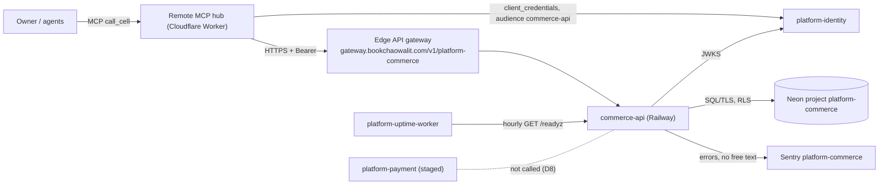
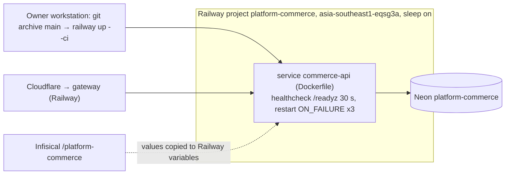

# Book Commerce Platform — System Architecture

เอกสารนี้สรุปสถาปัตยกรรมของ `commerce-api` จากโค้ดและ config ที่ `origin/main` `540ca8b` (runtime ที่ live คือ `d678a5f`) รายละเอียดเชิงลึกอยู่ใน Core 22 diagram pack [`docs/diagrams/`](../docs/diagrams/README.md) ซึ่งเอกสารนี้ลิงก์ไปแทนการคัดลอก สิ่งที่ยืนยันจาก repo ไม่ได้ติด **[ต้องยืนยัน]** หรืออยู่ในคำถามค้าง

## 1. Architecture style และเหตุผล

**Style:** modular monolith ขนาดเล็กหนึ่ง process (FastAPI) ต่อหนึ่ง bounded context (`commerce`: catalog, promotion, cart, pricing, order) วางบน shared library `platform-backend-core` ที่ pin ด้วย commit, ข้อมูลแยกต่อ workspace ด้วย PostgreSQL forced RLS, deploy เป็น serverless container (sleep เมื่อว่าง)

เหตุผลที่เห็นจากหลักฐาน:

- เป็น *platform boundary* ไม่ใช่ end-user product (`PRODUCT.md` §Positioning): ผู้บริโภคต้องพึ่งเฉพาะ versioned API/contract (`contract.json`) ไม่ใช่ DB หรือ module ภายใน — จึงเป็น service แยกที่มี DB ของตัวเอง
- 8 platform service ใช้ core เดียวกัน (auth, HTTP boundary, DB pool, migrations, probes) เพื่อให้ security/ops behaviour เหมือนกันทุกตัว; แต่ละ repo เป็นเจ้าของ domain code เอง ([ADR-0001](../docs/diagrams/08-adr/ADR-0001-fastapi-on-shared-backend-core.md))
- ยังไม่มี consumer จริงและ traffic ต่ำ จึงเลือก serverless + Neon free tier ต่อ project ([ADR-0004](../docs/diagrams/08-adr/ADR-0004-railway-serverless-neon-cli-deploy.md))
- ไม่มี async/event: ทุก operation เป็น synchronous REST ใน transaction เดียว

## 2. Quality-attribute scenarios

| ID | Attribute | Stimulus → Response | Measure | หลักฐาน |
|---|---|---|---|---|
| QA-01 | Security (isolation) | token ของ workspace A อ่าน/แก้ cart หรือ order ของ workspace B | ไม่เห็นแถวของ B (RLS), 404 | forced RLS ใน `migrations.py`; `runtime_tests/test_store.py`, `test_http.py` |
| QA-02 | Security (authz) | เรียก `/v1/*` ไม่มี token หรือ scope ไม่พอ | 401 / 403, ไม่มีข้อความภายในรั่ว | `app.py` `require_scope(...)` 16 routes, core `http.py` |
| QA-03 | Reliability (idempotency) | client ส่ง place order ซ้ำ/พร้อมกันด้วย `Idempotency-Key` เดียว | order เดียวต่อ cart, คำตอบเดิม | [ADR-0007](../docs/diagrams/08-adr/ADR-0007-idempotent-order-placement-integer-money.md), concurrent tests ใน `test_store.py` |
| QA-04 | Correctness (money) | คำนวณราคา + promotion | integer minor units, ไม่มี float | `pricing.py`, `runtime_tests/test_pricing.py` |
| QA-05 | Availability (cold start) | request แรกหลัง Railway sleep + Neon suspend | ตอบได้ภายใน pool wait 20 s (connect 15 s); warm `/readyz` ~1.2 s (วัด 2026-11-04) | core `db.py`@21d5f44, ops record |
| QA-06 | Privacy | exception มีข้อมูลลูกค้าใน message | Sentry ได้แค่ type/stack/route/tags ไม่มี free text | [ADR-0006](../docs/diagrams/08-adr/ADR-0006-sentry-errors-only-no-free-text.md), `runtime_tests/test_sentry.py` |
| QA-07 | Robustness | body ใหญ่ / request ช้า | ปฏิเสธ body > 16 KiB, timeout 30 s, statement timeout 10 s | `app.py` `max_body_bytes=16384`, core `http.py` |
| QA-08 | Modifiability | แก้ core (เช่น pool fix) | เปลี่ยน pin หนึ่งบรรทัดใน `pyproject.toml` + `uv.lock` + `Dockerfile`, CI ตรวจ pin ตรงกัน | `tests/test_build_hygiene.py` |

## 3. Context diagram

ภาพ C4 เต็ม: [05-c4-context.md](../docs/diagrams/05-c4-context.md). Direct Railway URL ยังเปิดสาธารณะ (auth บังคับที่ service เอง)

## 4. Components / containers

| Container | เทคโนโลยี | หน้าที่ | หลักฐาน |
|---|---|---|---|
| `commerce-api` (serve) | Python 3.12, FastAPI, uvicorn, `platform-backend-core@21d5f44` | 16 `/v1` routes + `/healthz` `/readyz` `/metrics`, PORT 8080, UID 65532 | `Dockerfile`, `__main__.py`, `app.py` |
| migrate one-off | image เดียวกัน, `python -m platform_commerce migrate` | DDL ด้วย owner/DDL role, advisory lock, ไม่รันตอน startup | `__main__.py`, `migrations.py` |
| Neon PostgreSQL | Postgres (CI 16) | 6 ตาราง + `platform_schema_migrations`, forced RLS | `migrations.py` |

Components ใน process ([07-c4-component.md](../docs/diagrams/07-c4-component.md)):

| Component | ไฟล์ | หน้าที่ |
|---|---|---|
| `_Boundary` middleware | core `http.py` | body limit, timeout 30 s, redacted 500, `x-request-id`, route metrics |
| `CaptureErrors` | `_sentry.py` | ชั้นในสุด ส่ง error ให้ Sentry แล้ว re-raise (core กลืน exception ก่อนถึง Sentry ASGI integration) |
| Routes + Strict pydantic | `app.py` | validate input, error string คงที่ |
| `require_scope` / `TokenVerifier` | core `http.py`, `auth.py` | RS256, `iss`/`aud`/`sub`/`ws`/`scope`, JWKS refresh ≤ 1 ครั้ง/60 s |
| `CommerceStore` | `store.py` | SQL ของ catalog/promotion/cart/order, row locks, readiness check `commerce_schema` |
| `pricing.quote` | `pricing.py` | ราคา integer minor units, promotion เดียวต่อ quote |
| `Database` | core `db.py` | pool max 8, ตั้ง `app.workspace_id` ต่อ transaction, ปฏิเสธ role ที่มีสิทธิ์เกิน |

## 5. Tech stack

| ชั้น | เทคโนโลยี | หลักฐาน |
|---|---|---|
| Runtime | Python ≥ 3.12, FastAPI (ผ่าน core), uvicorn `>=0.34,<1`, psycopg + psycopg_pool (core), PyJWT (core), `sentry-sdk>=2.72,<3` | `pyproject.toml`, `uv.lock` |
| Shared library | `platform-backend-core==0.1.0` pin git rev `21d5f44d…` | `pyproject.toml` `[tool.uv.sources]` |
| Build | Dockerfile สองชั้น `python:3.12-slim`, non-root | `Dockerfile` |
| Quality | uv (locked), Ruff, mypy, pytest + coverage gate 94%, gitleaks, semgrep, osv-scanner, trivy-fs | `.github/workflows/check.yml` |
| Contract | `book-platform.contract.v1` schema pin (sha256) | `schema/`, `scripts/check_schema_pin.py` |

## 6. Data stores

| Store | ข้อมูล | กฎ | หลักฐาน |
|---|---|---|---|
| Neon `platform-commerce` | `catalog_item`, `promotion`, `cart`, `cart_line`, `commerce_order`, `order_line`, `platform_schema_migrations` | ทุกตารางมี `workspace_id` + forced RLS บน `app.workspace_id`; runtime role NOSUPERUSER NOBYPASSRLS, readiness ตรวจ grants + checksum migrations | `migrations.py`, `store.py`, [09-erd.md](../docs/diagrams/09-erd.md), [ADR-0002](../docs/diagrams/08-adr/ADR-0002-postgres-forced-rls-per-workspace.md) |

ไม่มี cache, object storage (R2) หรือ queue

## 7. Integrations

| ระบบ | ทิศทาง | ใช้ทำอะไร | สถานะ | หลักฐาน |
|---|---|---|---|---|
| platform-identity (JWKS) | API → identity | ตรวจ RS256 token, audience `commerce-api`, 8 scopes (`catalog:*`, `cart:*`, `orders:*`, `promotions:*` read/write) | live | `__main__.py` (`JWT_ISSUER`, `JWT_AUDIENCE`, `JWT_JWKS_URL`/`JWT_PUBLIC_KEY`), [ADR-0003](../docs/diagrams/08-adr/ADR-0003-identity-rs256-scopes.md) |
| Edge API gateway | gateway → API | route `platform-commerce`, ส่ง token ต่อ | live (route), consumer = MCP hub | `platform-api-gateway@51c4711` `routes.json` |
| Remote MCP hub | hub → gateway → API | cell `platform-commerce`, 8 scopes | live | `platform-mcp-remote-worker@7d127c2` `src/worker.ts` `PLATFORM_CELLS`, `wrangler.toml` `CELLS` |
| Neon | API → DB | Postgres over TLS | live | `DATABASE_URL` |
| Sentry | API → Sentry | errors only, no free text | live | `_sentry.py` (`SENTRY_DSN`, `SENTRY_ENVIRONMENT`, `SENTRY_RELEASE`) |
| platform-uptime-worker | uptime → API | hourly `/readyz` | live | ops record, [20-observability.md](../docs/diagrams/20-observability.md) |
| platform-payment | — | ไม่เรียก; order ไม่รับเงิน | staged (D8) | [ADR-0005](../docs/diagrams/08-adr/ADR-0005-payment-outside-boundary-d8.md) |
| R2, queues/Kafka | — | not_applicable: ไม่มีใน code | — | `grep` ใน `src/` |

## 8. Deployment topology

- Deploy เป็น Railway CLI upload ไม่ได้ผูกกับ CI และไม่มี branch protection บน main ([16-deployment.md](../docs/diagrams/16-deployment.md), [18-git-release-workflow.md](../docs/diagrams/18-git-release-workflow.md))
- Live URL `https://commerce-api-production-9b24.up.railway.app`, `/readyz` 200 ใน 1.17 s (ตรวจ 2026-11-04)

## 9. ADR สำคัญ

| ADR | การตัดสินใจ |
|---|---|
| [ADR-0001](../docs/diagrams/08-adr/ADR-0001-fastapi-on-shared-backend-core.md) | FastAPI service บน `platform-backend-core` ที่ pin ด้วย commit |
| [ADR-0002](../docs/diagrams/08-adr/ADR-0002-postgres-forced-rls-per-workspace.md) | PostgreSQL forced RLS ต่อ workspace + runtime role สิทธิ์ต่ำสุด |
| [ADR-0003](../docs/diagrams/08-adr/ADR-0003-identity-rs256-scopes.md) | เชื่อ RS256 token ของ platform-identity, authorize ต่อ route ด้วย scope |
| [ADR-0004](../docs/diagrams/08-adr/ADR-0004-railway-serverless-neon-cli-deploy.md) | Railway serverless + Neon project ของตัวเอง, deploy ด้วย CLI |
| [ADR-0005](../docs/diagrams/08-adr/ADR-0005-payment-outside-boundary-d8.md) | Payment อยู่นอก boundary ของ commerce (D8) |
| [ADR-0006](../docs/diagrams/08-adr/ADR-0006-sentry-errors-only-no-free-text.md) | Sentry ส่งเฉพาะ error ไม่มี free text |
| [ADR-0007](../docs/diagrams/08-adr/ADR-0007-idempotent-order-placement-integer-money.md) | เงินเป็น integer minor units และ place order แบบ idempotent |

## 10. Fitness functions (ที่มีอยู่แล้ว)

| Fitness function | ปกป้องอะไร | รันที่ |
|---|---|---|
| `scripts/check.sh` + `tests/test_contract_check.py`, `tests/test_drift_checks.py`, `scripts/check_schema_pin.py` | contract ตรง schema ที่ pin, ไม่ drift | CI `contract` (Py 3.11, 3.12) |
| `tests/test_build_hygiene.py` | core pin ตรงกันใน `pyproject.toml`/`uv.lock`/`Dockerfile`, SHA-pinned actions | CI `python` |
| `runtime_tests/test_store.py`, `test_http.py` บน PostgreSQL จริง + role NOBYPASSRLS | RLS isolation, idempotency, scope 401/403 | CI `python` |
| `runtime_tests/test_sentry.py` (real client) | ไม่มี free text ออกจาก process | CI `python` |
| Coverage gate 94% (ratchet ตาม ADR-0004 TDD/SDD) | ไม่ลด test coverage | CI `python` |
| `shared-runtime.yml`: build image, import, `id -u` ≠ 0 | image สร้างได้และไม่รันเป็น root | CI `image` |
| `security.yml`: gitleaks, semgrep, osv-scanner, trivy-fs | secret/dependency/code risk | CI `security` |
| `/readyz` (`commerce_schema`: checksums, forced RLS, grants) | DB ตรงกับ code ก่อนรับ traffic | Railway healthcheck + uptime worker |

ยังไม่มี: deployed smoke test อัตโนมัติ, `check_registry_alignment.py` ใน CI (ต้องมี solo-empire checkout)

## 11. เอกสารลงรายละเอียด (SDLC phase 07)

| Template | สถานะ | ไฟล์ / เหตุผล |
|---|---|---|
| infrastructure-and-network-design | partial | [16-deployment.md](../docs/diagrams/16-deployment.md), [13-threat-model.md](../docs/diagrams/13-threat-model.md); ยังไม่มีเอกสารตาม template เต็ม |
| observability-design | partial | [20-observability.md](../docs/diagrams/20-observability.md); ยังไม่มี SLO/alert catalog |
| capacity-performance-and-cost-plan | not_applicable | tier L0, ยังไม่มี consumer/traffic; ใช้ free tier (Railway sleep + Neon free) |
| failure-mode-analysis | partial | [14-backup-dr.md](../docs/diagrams/14-backup-dr.md), [21-incident-response.md](../docs/diagrams/21-incident-response.md) |
| async-integration-contract | not_applicable | ไม่มี event, queue, webhook หรือ scheduled job ใน code |
| frontend-architecture | not_applicable | API อย่างเดียว ไม่มี UI |
| tech-debt-register | partial | headline findings ใน [docs/diagrams/README.md](../docs/diagrams/README.md), [docs/UPGRADE-PLAN.md](../docs/UPGRADE-PLAN.md) |
| system-landscape | external | แถวของ commerce อยู่ใน landscape ของ portfolio (architecture-docs) **[ต้องยืนยัน]** |
| vendor-dependency-review (lock-in) | missing | Railway, Neon, Sentry ยังไม่มี exit plan |

## 12. คำถามค้าง

- Q-01: จะปิด direct Railway URL ให้รับเฉพาะ traffic จาก gateway เมื่อไร (ต้องมี gateway-signed assertion)?
- Q-02: Neon `platform-commerce` อยู่ใน nightly backup + restore drill หรือไม่; RTO/RPO
- Q-03: `migrate` รันบน Railway อย่างไร (one-off service / `railway run` / เครื่อง owner)
- Q-04: ควร deploy ผ่าน CI (หลัง check เขียว) แทน CLI และเพิ่ม branch protection หรือไม่
- Q-05: `README.md` และ `docs/runtime.md` ยังเขียน "not deployed" — อัปเดตเมื่อไร
- Q-06: `contract.json` source path (`commerce-product-scraper`) ไม่ตรงกับ README (`book-ecommerce-scraping`) — อันไหนถูก

## การอนุมัติ

| บทบาท | สถานะ | วันที่ | ลงนาม |
|---|---|---|---|
| Solution Architect (Book Dev) | รอตรวจ | — | [ต้องยืนยัน] |
| Owner | รอตรวจ | — | [ต้องยืนยัน] |

## แหล่งข้อมูล

- repo `bookchaowalit-backend/platform-commerce` `origin/main` `540ca8b` (live runtime `d678a5f`)
- `PRODUCT.md`, `README.md`, `contract.json`, `docs/runtime.md`, `docs/CONTRACT-SURFACE.md`, `docs/UPGRADE-PLAN.md`
- `pyproject.toml`, `uv.lock`, `Dockerfile`, `.railway/railway.ts`, `.github/workflows/check.yml`, `.github/workflows/shared-runtime.yml`
- `src/platform_commerce/{__main__,app,store,pricing,migrations,_sentry}.py`, `tests/`, `runtime_tests/`
- `docs/diagrams/` (Core 22 pack, commit `540ca8b`) และ `docs/diagrams/08-adr/ADR-0001…0007`
- `bookchaowalit-backend/platform-api-gateway@51c4711` `routes.json`; `bookchaowalit/platform-mcp-remote-worker@7d127c2` `src/worker.ts`, `wrangler.toml`
- ops record: book-platforms-status, api-gateway-edge (2026-11-03); `curl /readyz` 2026-11-04
