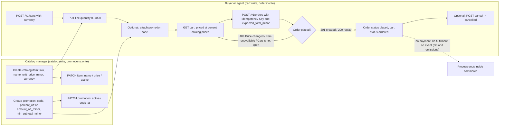
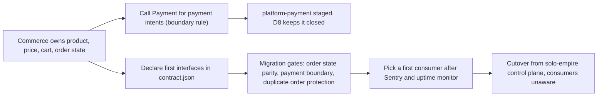

# 01 — Business process (As-Is / To-Be)

ขอบเขต: capability `commerce` (catalog, cart, pricing, order, promotion) ของ platform-commerce. Service นี้เป็น backend API
ไม่มีหน้า UI; "process" คือลำดับ API call ที่ caller ทำต่อ workspace หนึ่ง (workspace มาจาก JWT claim `ws` เท่านั้น).

## As-Is (จาก code วันนี้, main `fa79d31`; runtime ที่ deploy คือ `d678a5f`)

สิ่งที่ code ทำจริง:
- ราคาเป็น integer minor unit ของ currency เดียวต่อ cart; ไม่มี conversion (`pricing.quote`).
- Promotion หนึ่งตัวต่อ cart, ไม่ stack; ใช้ได้เมื่อ `active`, ยังไม่ถึง `ends_at`, currency ตรง และ subtotal ≥ `min_subtotal_minor`.
- `POST /v1/orders` ล็อก advisory ต่อ (workspace, key) แล้วล็อก cart `FOR UPDATE` และ catalog/promotion rows `FOR SHARE`; order เก็บ snapshot ของ line.
- Order มีแค่ `placed` และ `cancelled` (CHECK constraint); ไม่มี payment intent, capture, refund, ledger (owner decision D8).
- ไม่มี event/outbox: ไม่มี service อื่นรู้ว่า order ถูก placed; ไม่มี inventory, tax, shipping.

Sources: `src/platform_commerce/app.py`, `src/platform_commerce/store.py`, `src/platform_commerce/pricing.py`, `src/platform_commerce/migrations.py`, `docs/runtime.md` ("Deliberate omissions"), `contract.json`

## To-Be (เฉพาะที่เขียนไว้ใน PRODUCT.md / docs/UPGRADE-PLAN.md / docs/CONTRACT-SURFACE.md / docs/runtime.md)

- Boundary rule "must call Payment for payment intents and must not create ledger entries" (`docs/CONTRACT-SURFACE.md`) — ยังไม่ทำ เพราะ D8 (`docs/runtime.md`).
- UPGRADE-PLAN P0: derive interface จาก `book-ecommerce-scraping` แล้ว declare ใน `contract.json` (`interfaces` ยังว่าง).
- Staging plan ขั้น 4 "then Sentry and the uptime monitor; only after that pick a first consumer" — ขั้น Sentry/uptime ทำแล้วตาม ops record; ยังไม่มี consumer.

Sources: `PRODUCT.md`, `docs/UPGRADE-PLAN.md`, `docs/CONTRACT-SURFACE.md`, `docs/runtime.md`, ops record: book-platforms-status (2026-11-03)

## Open questions
- To-Be process หลัง order placed (payment, fulfilment ผ่าน `platform-logistics`, notification) ไม่มี spec ใน repo — ต้องให้ owner เขียนก่อน reopen D8.
- Consumer รายแรกคือใคร (web app ใด หรือ agent ใด)?
- Legacy source: `contract.json` ชี้ `commerce-product-scraper` แต่ README/CONTRACT-SURFACE/UPGRADE-PLAN ชี้ `book-ecommerce-scraping`; อันไหนถูก?
