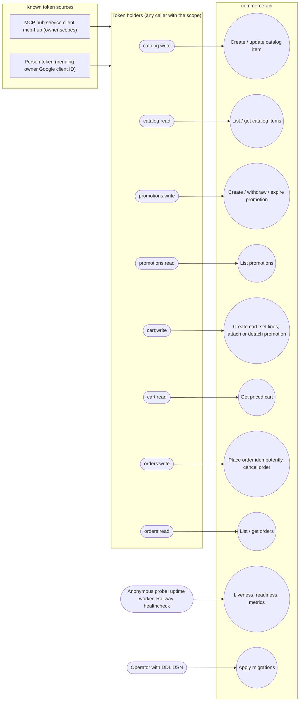

# 02 — Use cases

Actors คือสิ่งที่ service ตรวจจริง: bearer JWT แบบ RS256 (issuer platform-identity, audience `commerce-api`) ที่มี claim `sub` (actor),
`ws` (workspace) และ `scope`. Service **ไม่แยก** person token กับ service client: ทุก route ตรวจแค่ scope เดียวผ่าน `require_scope(...)`.
Token ที่มี `del` หรือ `obo` ถูกปฏิเสธ (core `TokenVerifier`). Probe routes ไม่ต้องใช้ token.

| Actor (scope) | Use cases | Routes |
|---|---|---|
| `catalog:write` | create item, update name/price/active | `POST /v1/catalog/items`, `PATCH /v1/catalog/items/{id}` |
| `catalog:read` | list (paged by id), get item | `GET /v1/catalog/items`, `GET /v1/catalog/items/{id}` |
| `promotions:write` | create promotion, withdraw (`active:false`) or set `ends_at` | `POST /v1/promotions`, `PATCH /v1/promotions/{id}` |
| `promotions:read` | list promotions | `GET /v1/promotions` |
| `cart:write` | create cart, set line, attach/detach promotion | `POST /v1/carts`, `PUT .../lines/{item_id}`, `PUT`/`DELETE .../promotion` |
| `cart:read` | read priced cart or ordered snapshot | `GET /v1/carts/{id}` |
| `orders:write` | place order (Idempotency-Key), cancel | `POST /v1/orders`, `POST /v1/orders/{id}/cancel` |
| `orders:read` | list, get orders | `GET /v1/orders`, `GET /v1/orders/{id}` |
| anonymous | liveness, readiness, Prometheus text | `GET /healthz`, `GET /readyz`, `GET /metrics` (core) |
| operator (DDL role) | `python -m platform_commerce migrate` | CLI only, never at startup |

Workspace isolation: ทุก store call ใช้ `Database.transaction(p.workspace)`; workspace อื่นอ่านเป็น 404 (RLS).

Sources: `src/platform_commerce/app.py`, `src/platform_commerce/__main__.py`, `src/platform_commerce/store.py`, `docs/runtime.md`, `platform-backend-core@21d5f44` `platform_backend_core/auth.py` + `http.py` (pinned in `pyproject.toml`), ops record: book-platforms-status (2026-11-03)

## Open questions
- MCP hub client `mcp-hub` ถือ commerce scope ชุดไหนบ้าง (ops record บอกแค่ "31 owner scopes, 8 audiences" และ call_cell commerce 200)?
- มี service client อื่น (นอกจาก mcp-hub) ที่ได้ audience `commerce-api` หรือไม่?
- ต้องการแยกสิทธิ์ person กับ service client หรือ role ภายใน workspace (เช่น buyer ไม่ควรแก้ราคา) หรือไม่ — code วันนี้ใช้ scope อย่างเดียว.
