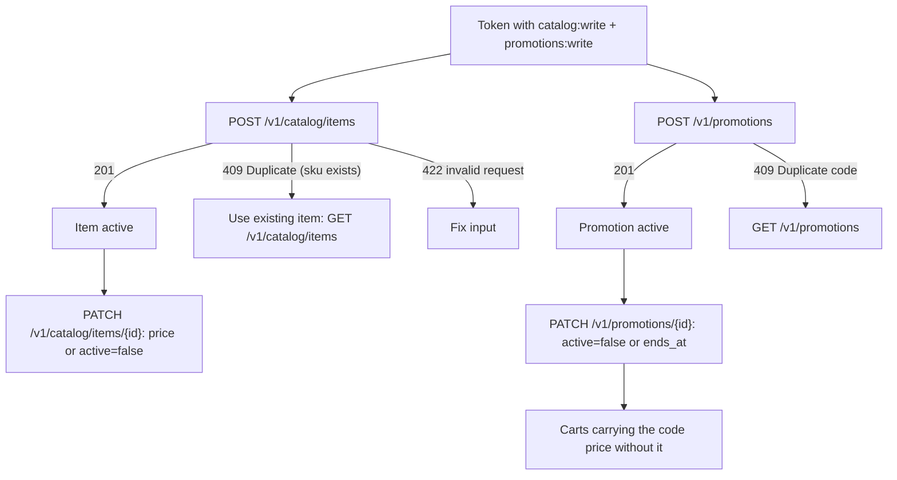
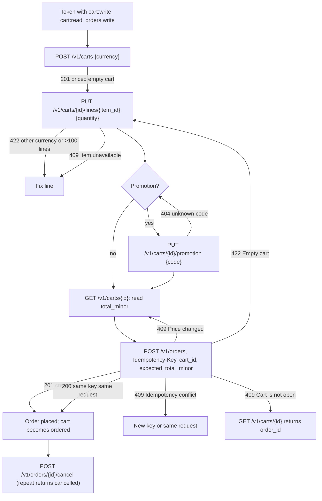
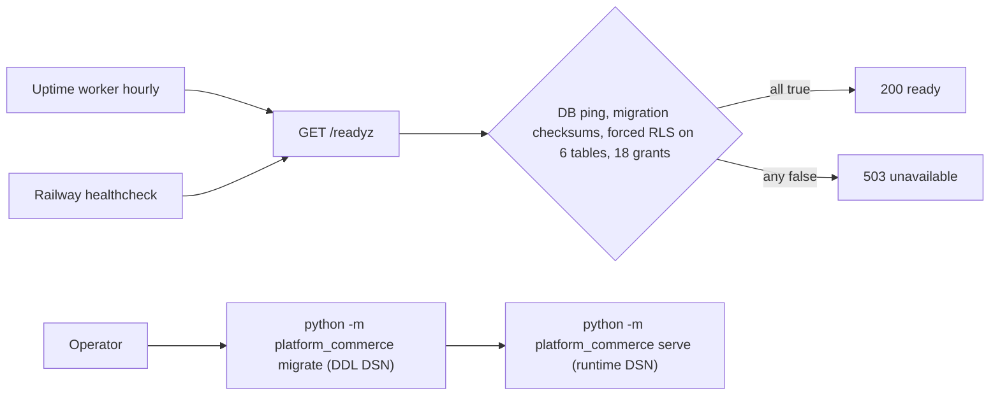

# 03 — User flows (API call flows per caller)

ไม่มี UI; flow = ลำดับ API call ต่อ caller. ทุก call ต้องมี `Authorization: Bearer <RS256 JWT>`; ไม่มี token = 401, ไม่มี scope = 403.

## Flow A — Catalog manager ตั้งค่า catalog และ promotion

## Flow B — Buyer / agent checkout

## Flow C — Probes และ operator

Sources: `src/platform_commerce/app.py`, `src/platform_commerce/store.py`, `src/platform_commerce/__main__.py`, `railway.toml`, `docs/runtime.md`, `runtime_tests/test_http.py`, `platform-backend-core@21d5f44` `platform_backend_core/http.py`, ops record: book-platforms-status (2026-11-03)

## Open questions
- Caller จริงที่เดิน Flow B วันนี้มีแค่ MCP hub (owner) — ยังไม่มี app consumer; flow ของ consumer ในอนาคตยังไม่ได้ออกแบบ.
- `POST /v1/carts` ไม่ idempotent (retry = cart ใหม่) — ยอมรับได้หรือควรมี key?
