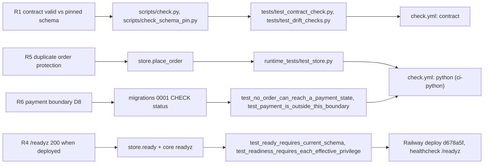

# 04 — Traceability (RTM)

ไม่มี `specs/` ใน repo. Requirement มาจาก `PRODUCT.md` (Success, Measures), `docs/CONTRACT-SURFACE.md` (migration gates,
boundary rules) และ `docs/runtime.md` (API contract, owner decision D8). Release = Railway CLI deployment (ไม่มี git tag/release).

| ID | Requirement (source) | Code module | Test file / test | CI or release |
|---|---|---|---|---|
| R1 | Contract valid against pinned shared schema (`PRODUCT.md` Success) | `scripts/check.py`, `scripts/check_schema_pin.py` | `tests/test_contract_check.py` (19), `tests/test_drift_checks.py` `SchemaPinTests` | `check.yml` job `contract` (3.11, 3.12) |
| R2 | Registry entry matches contract, drift 0 (`PRODUCT.md` Measures) | `scripts/check_registry_alignment.py` | `tests/test_drift_checks.py` `RegistryAlignmentTests` | local only (`--solo-empire`), **not in CI** |
| R3 | Runtime suite passes on PostgreSQL in CI, coverage ≥ gate (`PRODUCT.md`) | all `src/platform_commerce/*` | `runtime_tests/*` | `check.yml` job `python` (Postgres, coverage 94) |
| R4 | Deployed API answers `/readyz` (`PRODUCT.md`) | `store.ready`, core `readyz` | `runtime_tests/test_store.py::test_ready_requires_current_schema`, `test_http.py::test_readiness_requires_each_effective_privilege`, `test_missing_schema_is_not_ready`, `test_applied_migration_checksum_required` | `railway.toml` healthcheck; live 200 (curl 2026-11-03) |
| R5 | Duplicate order protection (migration gate) | `store.place_order`, `order_fingerprint`, `UNIQUE(workspace_id,idempotency_key)`, `UNIQUE(workspace_id,cart_id)` | `test_store.py::test_concurrent_replays_of_one_key_create_one_order`, `test_changed_request_for_a_key_is_a_conflict`, `test_a_cart_becomes_at_most_one_order_even_under_different_keys`, `test_idempotency_key_shape_is_enforced` | `python` job |
| R6 | Payment boundary: no payment state (gate + D8) | `migrations.py` CHECK `status IN ('placed','cancelled')`, no payment route | `test_store.py::test_no_order_can_reach_a_payment_state`, `test_http.py::test_payment_is_outside_this_boundary` | `python` job |
| R7 | Order state parity (gate) | `store.cancel_order` | `test_store.py::test_cancel_is_a_terminal_idempotent_transition` | `python` job; parity vs legacy **not possible** (no legacy order source) |
| R8 | Workspace isolation from JWT `ws` only (`runtime.md`) | `migrations._rls`, core `Database.transaction` | `test_store.py::test_carts_are_invisible_to_other_workspaces`, `test_forced_rls_rejects_writes_for_another_workspace`, `test_catalog_items_are_workspace_scoped_and_sku_unique`; `test_http.py::test_scopes_tokens_and_workspaces_are_enforced` | `python` job |
| R9 | Deterministic integer pricing (`runtime.md` Pricing rules) | `pricing.quote` | `runtime_tests/test_pricing.py` (10 tests, 25 cases per runtime.md) | `python` job |
| R10 | Promotion withdraw/expiry, re-check at order (`runtime.md` C1) | `store.update_promotion`, `LIVE_PROMOTION` | `test_store.py::test_promotion_can_be_deactivated_or_expired_and_pricing_ignores_it`, `test_placing_an_order_rechecks_the_promotion`, `test_http.py::test_promotion_patch_deactivates_and_sets_an_expiry` | `python` job |
| R11 | Fixed error strings, input never echoed; only InvalidInput is 422 (`runtime.md` C4) | `app.py` exception handlers, `store.InvalidInput` | `test_http.py::test_validation_errors_are_generic_and_never_echo_input`, `test_unexpected_server_errors_are_500_not_validation_errors`, `test_store.py::test_client_input_errors_are_invalid_input` | `python` job |
| R12 | No free text to Sentry (PRODUCT.md Operating Context) | `_sentry.py` | `runtime_tests/test_sentry.py` (11 tests incl. `test_no_exception_text_leaves_the_process`) | `python` job; deployed `d678a5f` |
| R13 | Image builds from clean checkout, non-root, SHA-pinned actions (`runtime.md` Build hygiene) | `Dockerfile`, workflows | `tests/test_build_hygiene.py` | `shared-runtime.yml` job `image` |
| R14 | Migrations never at startup; generic startup error (`runtime.md`) | `__main__.py` | `runtime_tests/test_lifecycle.py` | `python` job |

Sources: `PRODUCT.md`, `docs/CONTRACT-SURFACE.md`, `docs/runtime.md`, `src/platform_commerce/*.py`, `scripts/*.py`, `tests/*.py`, `runtime_tests/*.py`, `.github/workflows/check.yml`, `.github/workflows/shared-runtime.yml`, `railway.toml`, Railway GraphQL `deployments` (read 2026-11-03)

## Open questions
- ไม่มี requirement ID ทางการ (specs/ หรือ issue). ID R1–R14 ตั้งขึ้นในไฟล์นี้เพื่อ trace เท่านั้น — owner ต้องการ spec folder ตาม ADR-0004 (TDD/SDD) หรือไม่?
- R2 (registry drift) ไม่มีใน CI จึงวัด Measure "drift target 0" อัตโนมัติไม่ได้.
