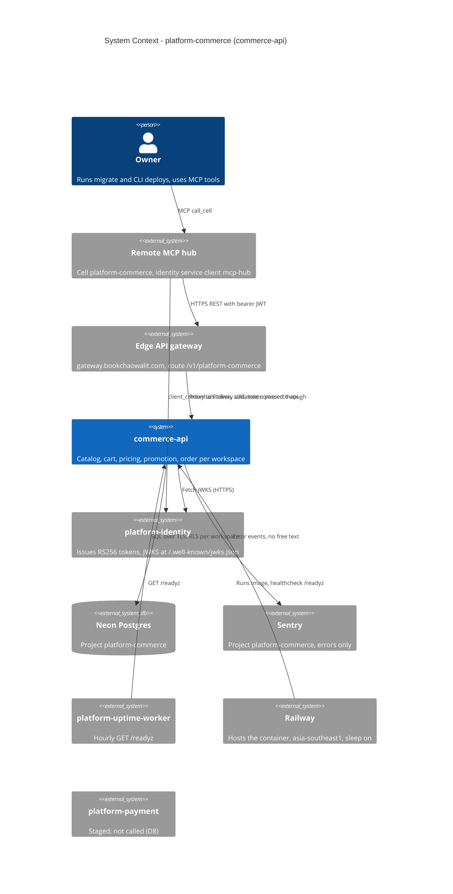

# 05 — C4 Context

หมายเหตุ: `platform-payment` แสดงไว้เพราะอยู่ใน `depends_on` ของ `contract.json` แต่ไม่มี call จริง (D8). `observability` ใน
`depends_on` คือ library/decision เปิดอยู่ (ops record) — ใน code มีแค่ Sentry และ `/metrics`.

Sources: ops record: api-gateway-edge (2026-11-03); `bookchaowalit-backend/platform-api-gateway@51c4711` `routes.json`; `bookchaowalit/platform-mcp-remote-worker@7d127c2` `wrangler.toml` `CELLS` + `src/worker.ts` `PLATFORM_CELLS`, `contract.json`, `src/platform_commerce/__main__.py`, `src/platform_commerce/_sentry.py`, `railway.toml`, `docs/runtime.md`, `PRODUCT.md`, ops record: book-platforms-status (2026-11-03)

## Open questions
- (ตอบแล้ว 2026-11-04) gateway มี route `platform-commerce` และ MCP hub เรียกผ่าน gateway; แต่ direct Railway URL ยังเปิดสาธารณะเพราะ service ไม่ตรวจ header ของ edge — จะปิด direct URL เมื่อไร (ต้องมี gateway-signed assertion ตาม ops record)?
- `/metrics` ไม่มี scraper (ops record: observability decision open) — ใครอ่าน?
