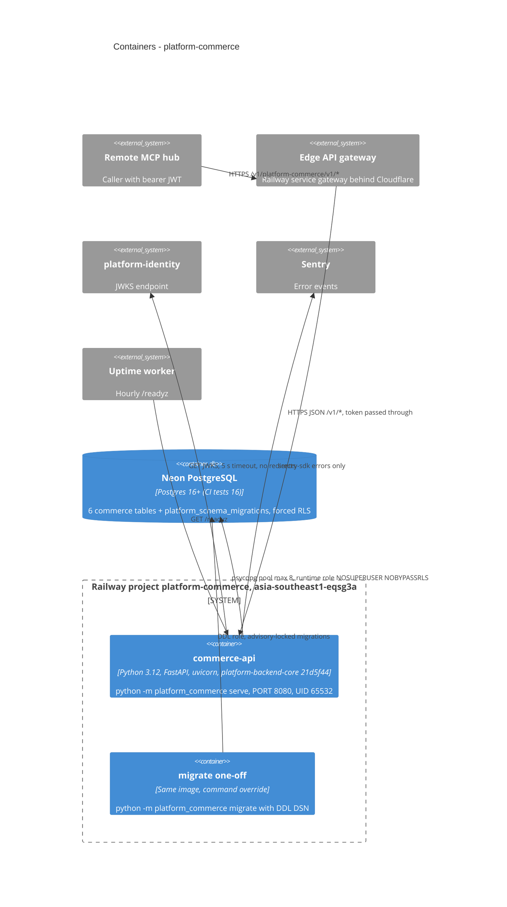

# 06 — C4 Container

Container facts:
- Image: two-stage `Dockerfile` (`python:3.12-slim`), wheels for this service and `platform-backend-core` built from commit `21d5f44d…`, runtime stage no git, `USER 65532:65532`, `CMD python -m platform_commerce serve`.
- Runtime limits: concurrency 100 (uvicorn), pool 8, statement timeout 10 s, request timeout 30 s, body ≤ 16 KiB (`create_app(..., max_body_bytes=16384)`).
- `migrate` ไม่เคยรันตอน startup; ต้องรันแยกด้วย DDL DSN.

Sources: ops record: api-gateway-edge (2026-11-03); `bookchaowalit-backend/platform-api-gateway@51c4711` `routes.json`; `bookchaowalit/platform-mcp-remote-worker@7d127c2` `wrangler.toml` `CELLS` + `src/worker.ts` `PLATFORM_CELLS`, `Dockerfile`, `.railway/railway.ts`, `pyproject.toml`, `src/platform_commerce/__main__.py`, `src/platform_commerce/app.py`, `docs/runtime.md`, `platform-backend-core@21d5f44` `db.py` + `http.py`, ops record: book-platforms-status (2026-11-03)

## Open questions
- `migrate` รันอย่างไรบน Railway จริง (service แยก, `railway run`, หรือจากเครื่อง owner)? ops record recipe บอก "migrate with the owner role" แต่ไม่บอกวิธี.
- Postgres version ของ Neon project `platform-commerce` ไม่ได้บันทึก.
