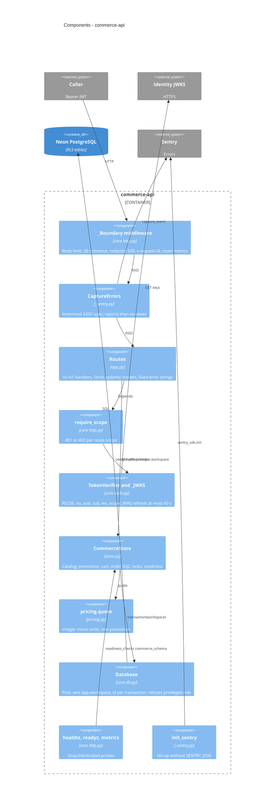

# 07 — C4 Component (commerce-api)

Sources: `src/platform_commerce/app.py`, `src/platform_commerce/store.py`, `src/platform_commerce/pricing.py`, `src/platform_commerce/_sentry.py`, `src/platform_commerce/__init__.py`, `platform-backend-core@21d5f44` `auth.py`, `http.py`, `db.py`

## Open questions
- ไม่มี
