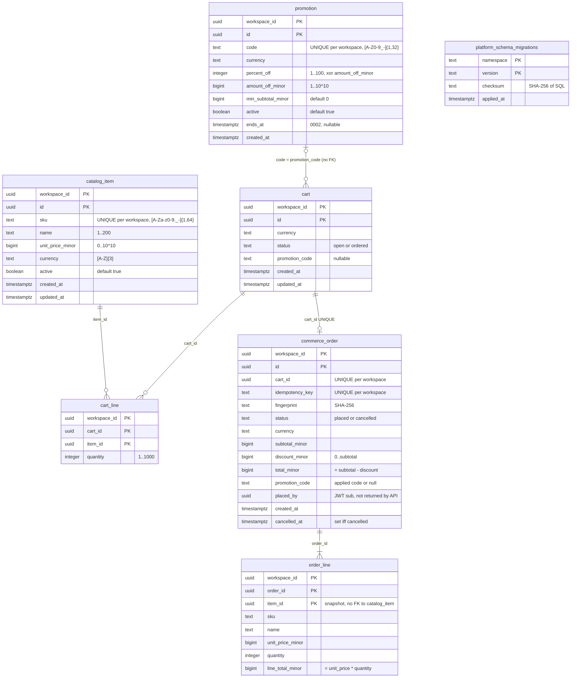

# 09 — ERD

Schema จาก `MIGRATIONS` (namespace `commerce`, versions `0001`, `0002`). ทุก PK/FK เป็น composite ที่ขึ้นต้นด้วย `workspace_id`.

## RLS และ runtime role
- ทั้ง 6 ตาราง (`TABLES`) มี `ENABLE` + `FORCE ROW LEVEL SECURITY` และ policy `workspace` (`USING` + `WITH CHECK` บน `app.workspace_id`).
- `platform_schema_migrations` สร้างโดย core `MigrationRunner` (ใช้ร่วมทุก namespace ใน DB เดียว) ไม่มี RLS; runtime role ต้องมีแค่ `SELECT`.
- Index เพิ่ม: `commerce_order(workspace_id, created_at, id)`.
- Runtime grants (readiness ตรวจทีละรายการ): `catalog_item`, `promotion`, `cart` = SELECT/INSERT/UPDATE; `cart_line` = +DELETE;
  `commerce_order` = SELECT/INSERT/UPDATE; `order_line` = SELECT/INSERT. ไม่มี DELETE บน order ใดๆ.
- Personal data: เก็บแค่ `placed_by` (actor UUID); ไม่มีชื่อ/อีเมล/ที่อยู่.

Sources: `src/platform_commerce/migrations.py`, `src/platform_commerce/store.py` (`REQUIRED_PRIVILEGES`, `ready`), `docs/runtime.md`, `platform-backend-core@21d5f44` `migrations.py`

## Open questions
- Retention ของ cart ที่ไม่ได้สั่ง และ order/idempotency key — ไม่มี purge job (runtime.md "Deliberate omissions").
