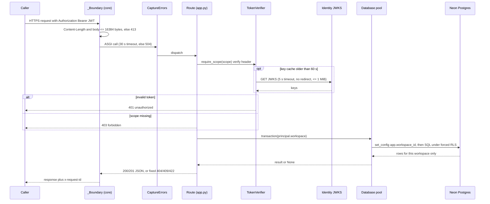
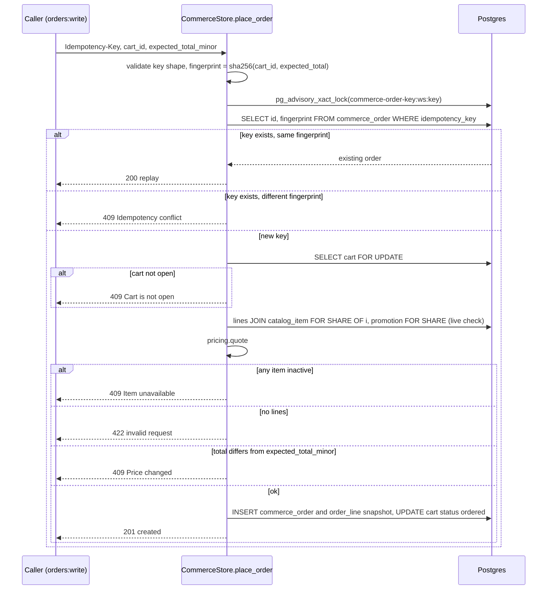
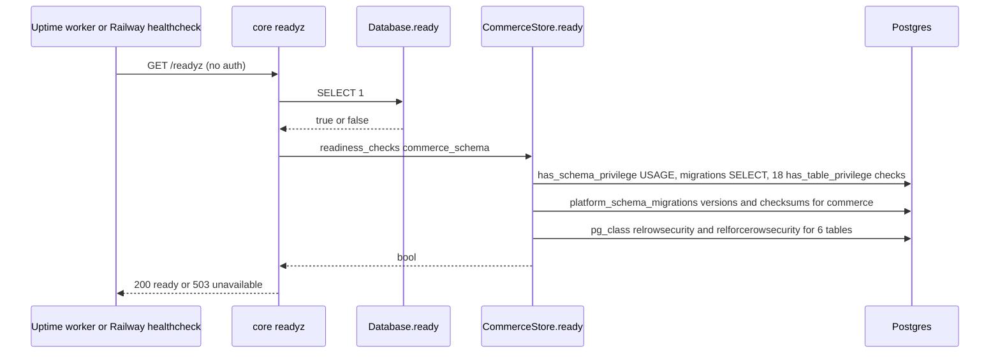

# 10 — Sequences

## S1 — Authenticated request (ทุก /v1 route)

## S2 — Place order (duplicate order protection)

## S3 — Readiness probe

Sources: `src/platform_commerce/app.py`, `src/platform_commerce/store.py`, `src/platform_commerce/_sentry.py`, `platform-backend-core@21d5f44` `http.py`, `auth.py`, `db.py`, `.railway/railway.ts`, ops record: book-platforms-status (2026-11-03)

## Open questions
- ไม่มี
