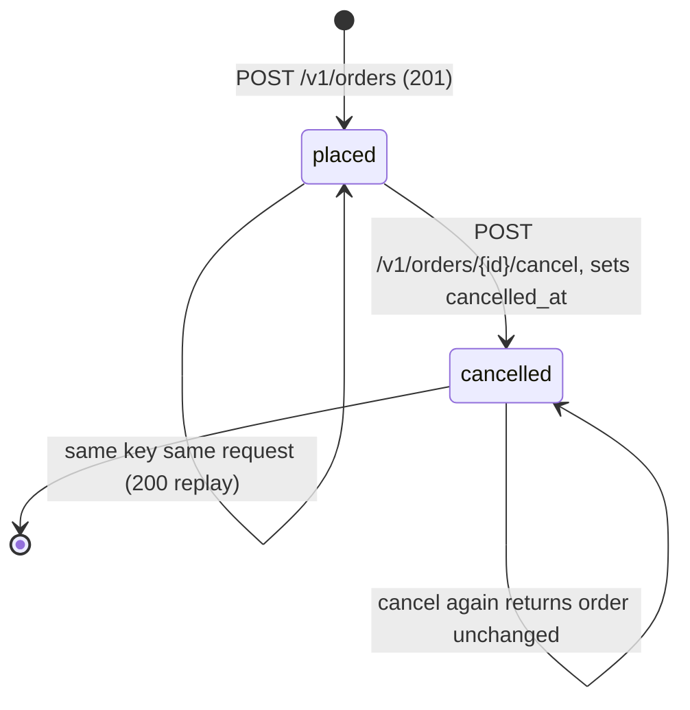
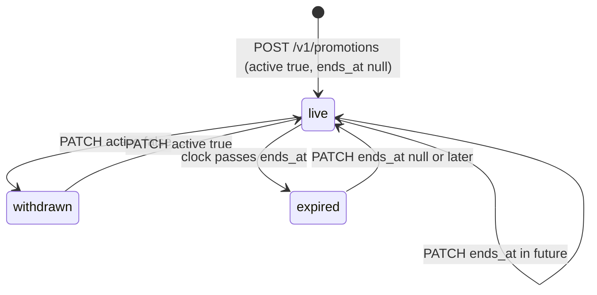
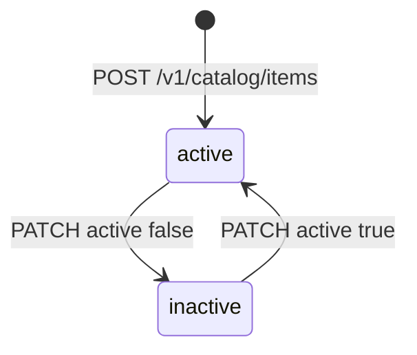

# 11 — State machines

## Cart (`cart.status`)

```mermaid
stateDiagram-v2
  [*] --> open: POST /v1/carts
  open --> open: PUT line, PUT or DELETE promotion
  open --> ordered: POST /v1/orders succeeds
  ordered --> ordered: GET returns order snapshot; writes give 409 Cart is not open
```

## Order (`commerce_order.status`)

CHECK constraint อนุญาตแค่ `placed`, `cancelled`; `paid`/`captured`/`refunded` ถูกปฏิเสธ (D8). `cancelled_at IS NOT NULL` เมื่อ cancelled เท่านั้น.

## Promotion (`active` + `ends_at`, ไม่มี status column)

"live" = `active AND (ends_at IS NULL OR ends_at > clock_timestamp())` (`LIVE_PROMOTION`). Cart ที่ถือ code ที่ไม่ live แสดง `promotion_applied: false`; `place_order` ตรวจซ้ำ.

## Catalog item (`active`)

Inactive item: `PUT line` = 409 `Item unavailable`; cart ที่มี item นี้สั่งไม่ได้ (409).

Sources: `src/platform_commerce/migrations.py`, `src/platform_commerce/store.py`, `src/platform_commerce/app.py`, `runtime_tests/test_store.py`

## Open questions
- ไม่มี
