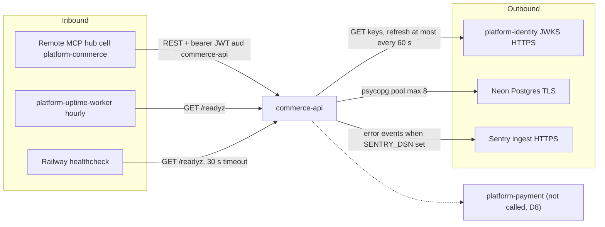

# 12 — API and integrations

Reuse: รายละเอียด field-level อยู่ใน [`docs/runtime.md` § API](../runtime.md#api) แล้ว; ไฟล์นี้สรุป route ทั้งหมดจาก router code
พร้อม scope และพฤติกรรม idempotency. `contract.json` `interfaces` ยังว่าง ([`docs/CONTRACT-SURFACE.md`](../CONTRACT-SURFACE.md)).

## Routes (`src/platform_commerce/app.py` + core probes)

| Method | Path | Scope | Success | Idempotency / retry behaviour |
|---|---|---|---|---|
| POST | `/v1/catalog/items` | `catalog:write` | 201 | ไม่มี key; retry ด้วย SKU เดิม = 409 `Duplicate` (UNIQUE sku) |
| GET | `/v1/catalog/items` | `catalog:read` | 200 | safe; `limit` 1..100, `after` UUID, order by id |
| GET | `/v1/catalog/items/{item_id}` | `catalog:read` | 200 / 404 | safe |
| PATCH | `/v1/catalog/items/{item_id}` | `catalog:write` | 200 / 404 | ค่าเดิมซ้ำได้ผลเดิม (`coalesce`); `updated_at` เปลี่ยนทุกครั้ง |
| POST | `/v1/promotions` | `promotions:write` | 201 | retry code เดิม = 409 `Duplicate` |
| PATCH | `/v1/promotions/{promotion_id}` | `promotions:write` | 200 / 404 | idempotent set ของ `active` / `ends_at`; empty body หรือ `active: null` = 422 |
| GET | `/v1/promotions` | `promotions:read` | 200 | safe, paged |
| POST | `/v1/carts` | `cart:write` | 201 | **ไม่ idempotent**: retry = cart ใหม่ |
| GET | `/v1/carts/{cart_id}` | `cart:read` | 200 / 404 | safe; ordered cart = order snapshot |
| PUT | `/v1/carts/{cart_id}/lines/{item_id}` | `cart:write` | 200 | idempotent (set quantity; 0 ลบ line) |
| PUT | `/v1/carts/{cart_id}/promotion` | `cart:write` | 200 / 404 | idempotent |
| DELETE | `/v1/carts/{cart_id}/promotion` | `cart:write` | 200 | idempotent |
| POST | `/v1/orders` | `orders:write` | 201 / 200 replay | header `Idempotency-Key` บังคับ; fingerprint mismatch = 409 `Idempotency conflict` |
| GET | `/v1/orders` | `orders:read` | 200 | safe, paged |
| GET | `/v1/orders/{order_id}` | `orders:read` | 200 / 404 | safe |
| POST | `/v1/orders/{order_id}/cancel` | `orders:write` | 200 / 404 | idempotent (cancel ซ้ำคืน order เดิม) |
| GET | `/healthz` | none | 200 `{"status":"ok"}` | core |
| GET | `/readyz` | none | 200 / 503 | core + `commerce_schema` check |
| GET | `/metrics` | none | 200 text | core; route template × status counters + duration sum |

Error contract: 401 `unauthorized` (+`WWW-Authenticate: Bearer`), 403 `forbidden`, 404 `Not found`, 409 one of `Duplicate`,
`Cart is not open`, `Item unavailable`, `Idempotency conflict`, `Price changed`, 413 `request too large`, 422 `invalid request`,
500 `internal server error`, 504 `request timeout`. ไม่มี input echo.

## Integrations

| Integration | Direction | Mechanism | Failure behaviour |
|---|---|---|---|
| platform-identity JWKS | out | `urllib` HTTPS, 5 s timeout, no redirects, ≤ 1 MiB, ≤ 64 keys, RSA/RS256 only | any failure → empty key cache for 60 s → 401 |
| Neon Postgres | out | `psycopg_pool`, connect timeout 15 s, pool wait 20 s, statement + idle-in-tx timeout 10 s | 500 / 504; `/readyz` 503 |
| Sentry | out | `sentry-sdk` errors only | no-op without DSN |
| MCP hub | in | identity `client_credentials` token per audience | — |
| Webhooks | — | none | — |
| Events / outbox | — | none (runtime.md omission) | — |

Sources: `src/platform_commerce/app.py`, `src/platform_commerce/store.py`, `src/platform_commerce/__main__.py`, `src/platform_commerce/_sentry.py`, `.railway/railway.ts`, `contract.json`, `docs/runtime.md`, `docs/CONTRACT-SURFACE.md`, `platform-backend-core@21d5f44` `http.py`, `auth.py`, `db.py`, ops record: book-platforms-status (2026-11-03), live curl 2026-11-03 (`/readyz` 200, `/healthz` ok, `/v1/orders` 401 without token)

## Open questions
- ควร declare route เหล่านี้ใน `contract.json` `interfaces` ตอนไหน (CONTRACT-SURFACE บอกห้าม invent route ก่อน derive จาก legacy source)?
- Gateway route สำหรับ commerce มีหรือไม่ (ops record ไม่ระบุ).
