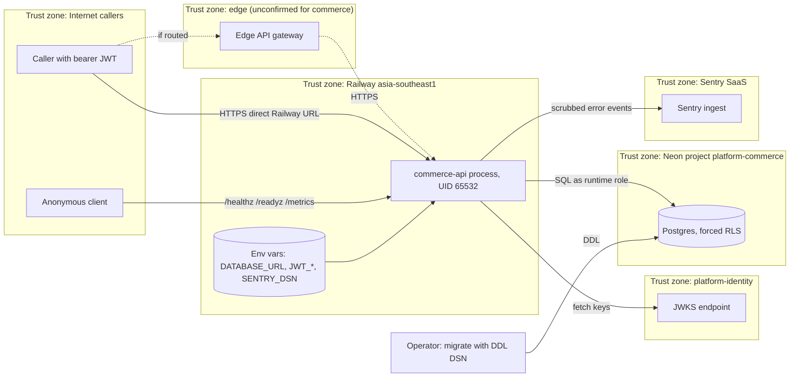

# 13 — Threat model (DFD + STRIDE)

## STRIDE

| Element | Threat | Existing mitigation (code) | Gap |
|---|---|---|---|
| Caller → API | **S** forged token | RS256 only, `iss`/`aud` strict, required claims, lifetime ≤ 3600 s, `crit` refused (core `auth.py`) | no revocation; `del`/`obo` simply refused |
| Caller → API | **T** body tampering / mass assignment | `Strict` pydantic (`extra='forbid'`, strict types), DB CHECKs | — |
| Caller → API | **R** who changed catalog/promotion | `placed_by` on orders only | no `updated_by` / audit trail for catalog, promotion, cart, cancel |
| Caller → API | **I** error leakage | fixed error strings, input never echoed, redacted 500 | — |
| Caller → API | **D** flood | body ≤ 16 KiB, 30 s timeout, concurrency 100, pool 8, statement timeout 10 s, lists ≤ 100 | no rate limit in code; sleeping service wakes on any request |
| Caller → API | **E** cross-workspace access | workspace only from `ws`; forced RLS `USING`+`WITH CHECK`; scope per route | scope is not role-based inside a workspace |
| Gateway → API | **S** bypass edge | auth enforced at service (direct URL `/v1/orders` = 401 without token) | service does not check an edge header; direct Railway URL is public |
| Anonymous → probes | **I** recon | probes return status only; `/metrics` has route templates and counts only | `/metrics` unauthenticated |
| API → JWKS | **S/T** key substitution | HTTPS required, no redirects, size/count bounds, kid match, cache cleared on failure | JWKS URL trusted as configured |
| API → JWKS | **D** JWKS outage | refresh at most every 60 s | all requests 401 while keys unavailable |
| API → Neon | **E** privileged runtime role | core refuses SUPERUSER/BYPASSRLS; readiness checks each of 18 grants; no DELETE on orders | DDL DSN custody (Infisical) outside repo |
| API → Neon | **T** concurrent double order | advisory lock, `FOR UPDATE`/`FOR SHARE`, UNIQUE key and cart | — |
| API → Sentry | **I** PII / secret egress | no free text, no locals, no request data, no tracing, no propagation, logging integration off | stack frames still name file/function/line (by design) |
| Env / secrets | **I** leak at startup | startup errors exit with fixed message; `.dockerignore` drops `.env*` | — |
| Supply chain | **T** dependency confusion | core pinned by Git commit (uv source, lock, Dockerfile); actions pinned by SHA; security workflow (gitleaks, semgrep, osv-scanner, trivy-fs) | `uvicorn`/`sentry-sdk` ranges in `pyproject.toml` (locked in `uv.lock`, but Dockerfile `pip wheel` resolves fresh) |

ไม่มี provider (Stripe, Resend, R2) ใน service นี้; payment อยู่นอก boundary (D8).

Sources: `src/platform_commerce/app.py`, `src/platform_commerce/store.py`, `src/platform_commerce/migrations.py`, `src/platform_commerce/_sentry.py`, `src/platform_commerce/__main__.py`, `Dockerfile`, `.dockerignore`, `pyproject.toml`, `.github/workflows/check.yml`, `platform-backend-core@21d5f44` `auth.py`, `http.py`, `db.py`, `bookchaowalit/platform-ci-workflows@87dc5e1c` `.github/workflows/security.yml`, live curl 2026-11-03, ops record: book-platforms-status (2026-11-03). Central attack paths: [ATTACK-PATH-DIAGRAMS.md](https://github.com/bookchaowalit/architecture-docs/blob/main/docs/architecture/ATTACK-PATH-DIAGRAMS.md) (ไม่มีส่วนของ commerce).

## Open questions
- Commerce อยู่หลัง edge gateway หรือไม่ และควรปิด direct Railway URL หรือไม่?
- `/metrics` ควรต้องใช้ token หรือไม่?
- ต้องการ audit log สำหรับการแก้ราคา/promotion หรือไม่?
- Dockerfile `pip wheel` ไม่ใช้ `uv.lock` — image อาจได้ `uvicorn`/`sentry-sdk` คนละ version กับที่ CI ทดสอบ; ยอมรับหรือไม่?
