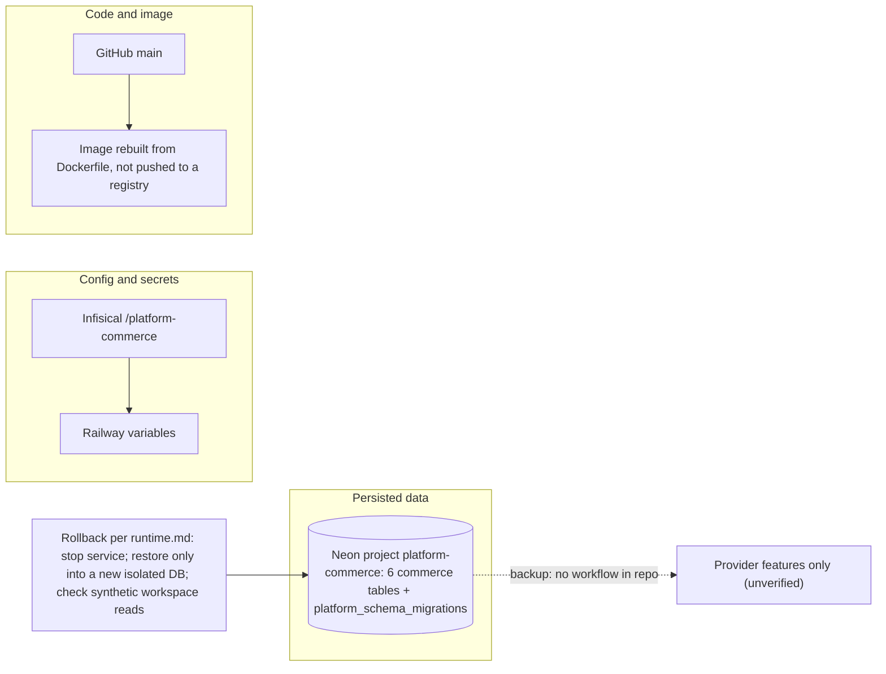

# 14 — Backup and DR

| Data | Where | Backup in repo | Restore reality |
|---|---|---|---|
| Catalog, promotions, carts, orders | Neon `platform-commerce` | **ไม่มี** (no backup workflow, no dump script) | runtime.md: restore เข้า DB ใหม่เท่านั้น, ห้าม downgrade SQL; ไม่มี drill record |
| Migration history | same DB `platform_schema_migrations` | — | migrations ใน code (`MIGRATIONS`) apply ซ้ำได้ (idempotent) |
| Secrets (DSNs, JWT config, SENTRY_DSN) | Infisical `/platform-commerce`, Railway | outside repo | re-set ผ่าน Railway variables |
| Image | built by Railway from `git archive` | Dockerfile reproducible จาก commit | `railway up` จาก commit เดิม |

- RTO: not defined. RPO: not defined.
- Runtime "has no consumers" (runtime.md) — ผลกระทบ data loss วันนี้ต่ำ แต่จะเปลี่ยนเมื่อมี consumer.
- Central baseline [ADR-0002 production baseline monitoring + backups](https://github.com/bookchaowalit/architecture-docs/blob/main/docs/architecture/decisions/ADR-0002-production-baseline-monitoring-backups.md) — ไม่พบหลักฐานใน repo นี้หรือ ops record ว่า commerce ถูกรวมใน nightly backup.

Sources: `docs/runtime.md` ("Rollback", "Staging plan"), `src/platform_commerce/migrations.py`, `Dockerfile`, `.railway/railway.ts`, `.github/workflows/*.yml`, `PRODUCT.md`, ops record: book-platforms-status (2026-11-03)

## Open questions
- Neon free project `platform-commerce` มี point-in-time restore window เท่าไร และเคยทดสอบ restore หรือไม่?
- Commerce ถูกเพิ่มใน nightly encrypted backup → R2 และ monthly restore drill หรือยัง?
- ตั้ง RTO/RPO เมื่อไร (ก่อนมี consumer รายแรก?)
