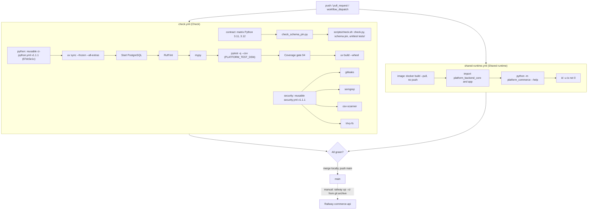

# 15 — CI/CD pipeline

ทุก workflow trigger บน `push` (ทุก branch), `pull_request`, `workflow_dispatch`; `permissions: contents: read`; concurrency ต่อ ref
(cancel-in-progress). รันบน GitHub-hosted runners (public repo). **ไม่มี deploy job** — deploy เป็น Railway CLI แยก (ดู 18).

Jobs ไม่มี `needs:` ระหว่างกัน (ขนานทั้งหมด). Coverage threshold "94" (measured 94.30% 2026-11-03, ratchet ตาม ADR-0004 TDD/SDD).

Run history 2026-10-01 → 2026-11-03 (`gh run list`): Check บน main 21 success / 2 failure (both 2026-10-13, `1a75145`, `86096a6`);
Shared runtime บน main 18 success.

Sources: `.github/workflows/check.yml`, `.github/workflows/shared-runtime.yml`, `bookchaowalit/platform-ci-workflows@87dc5e1c` `.github/workflows/ci-python.yml` + `security.yml`, `scripts/check.sh`, `pyproject.toml`, `tests/test_build_hygiene.py`, `gh run list -R bookchaowalit-backend/platform-commerce --limit 200 --json workflowName,headBranch,event,conclusion,createdAt,headSha` (2026-11-03). Central: [ADR-0004 TDD/SDD](https://github.com/bookchaowalit/architecture-docs/blob/main/docs/architecture/decisions/ADR-0004-tdd-sdd-standard.md)

## Open questions
- `scripts/check_registry_alignment.py` ไม่อยู่ใน CI (ต้องมี solo-empire checkout) — ควรเพิ่มไหม?
- `format-check: false` (follow-up: adopt ruff format) ยังค้าง.
