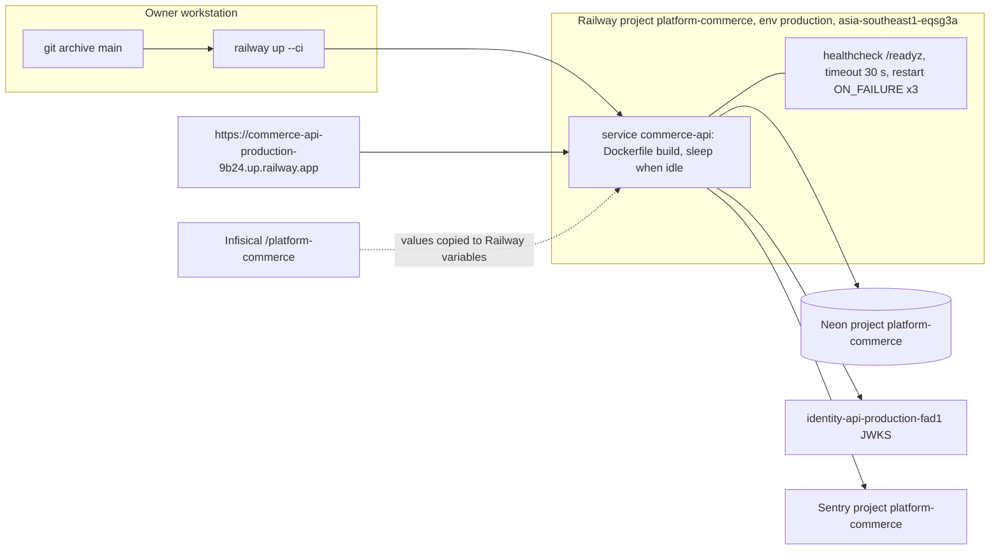

# 16 — Deployment

| Item | Value | Source |
|---|---|---|
| Builder | `DOCKERFILE` | `railway.toml` |
| Health | `/readyz` (readiness), `/healthz` (liveness, core) | `railway.toml`, core `http.py` |
| Process | `python -m platform_commerce serve`, `PORT` 8080 default, UID 65532 | `Dockerfile`, `__main__.py` |
| Env (names only) | `DATABASE_URL`, `JWT_ISSUER`, `JWT_AUDIENCE`, `JWT_JWKS_URL` or `JWT_PUBLIC_KEY`, `PORT`, `SENTRY_DSN`, `SENTRY_ENVIRONMENT`, `SENTRY_RELEASE`, `RAILWAY_GIT_COMMIT_SHA`, `RAILWAY_SERVICE_NAME` | `__main__.py`, `_sentry.py` |
| Region / sleep | `asia-southeast1-eqsg3a`, sleep on | ops record |
| Live commit | `d678a5f` (deploy 2026-11-03 04:23 UTC, `cliMessage` `sentry hardening port src-commerce-d678a5f`); main `fa79d31` changes CI/tooling only, not deployed | Railway GraphQL, `git diff --stat d678a5f fa79d31 -- src Dockerfile railway.toml` (empty) |
| Live check | `/readyz` 200 in 1.4 s, `/healthz` `{"status":"ok"}` (2026-11-03) | curl |

Serverless note: sleep + Neon suspend → first request รอ resume (core pool wait 20 s, connect 15 s). `RAILWAY_GIT_COMMIT_SHA` ไม่ถูกตั้งโดย CLI upload ดังนั้น Sentry `release` อาจว่าง เว้นแต่ตั้ง `SENTRY_RELEASE`.

Sources: `railway.toml`, `Dockerfile`, `src/platform_commerce/__main__.py`, `src/platform_commerce/_sentry.py`, `PRODUCT.md`, `docs/runtime.md`, ops record: book-platforms-status (2026-11-03), Railway GraphQL `deployments` (read 2026-11-03)

## Open questions
- `SENTRY_RELEASE` ถูกตั้งบน Railway หรือไม่ (ถ้าไม่ Sentry ไม่มี release)?
- `JWT_JWKS_URL` หรือ `JWT_PUBLIC_KEY` ที่ใช้จริง — ops record บอก JWKS แต่ไม่ได้ตรวจ variable names บน Railway.
- `docs/runtime.md` และ README ยังเขียนว่า "not deployed" — ควรอัปเดต.
