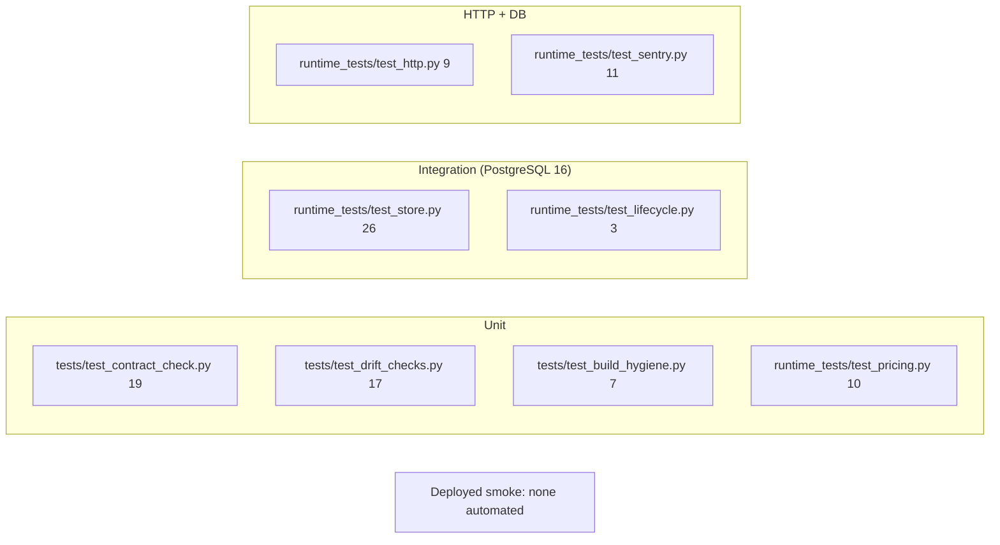

# 17 — Test coverage matrix

Levels: **unit** = ไม่ใช้ DB (`tests/`, `runtime_tests/test_pricing.py`, Sentry scrub units); **integration** = PostgreSQL จริง
(`PLATFORM_TEST_DSN`, throwaway DB + NOLOGIN NOSUPERUSER NOBYPASSRLS role); **http** = FastAPI TestClient + real RS256 tokens + DB;
**e2e/deployed** = ไม่มี automated test ต่อ Railway.

| Feature | Unit | Integration (DB) | HTTP | E2E / deployed |
|---|---|---|---|---|
| Contract + schema pin + registry drift | ✔ contract_check, drift_checks | — | — | — |
| Build hygiene (Dockerfile, SHA pins) | ✔ build_hygiene | — | — | CI `image` job builds |
| Pricing (minor units, promotion math) | ✔ test_pricing | ✔ promotion rules in store | ✔ flow | ✗ gap |
| Catalog CRUD + SKU unique + paging | — | ✔ | ✔ flow | ✗ gap |
| Promotion create / withdraw / expiry | — | ✔ | ✔ `test_promotion_patch_...` | ✗ gap |
| Cart lines, currency, inactive item | — | ✔ | ✔ flow | ✗ gap |
| Order idempotency + concurrency + one order per cart | — | ✔ (concurrent tests) | ✔ flow | ✗ gap (runtime.md staging step 3 is manual) |
| Cancel order | — | ✔ | ✔ flow | ✗ gap |
| Payment states refused (D8) | — | ✔ | ✔ | — |
| Workspace isolation / forced RLS | — | ✔ | ✔ scopes/workspaces | ✗ gap |
| AuthN/AuthZ (401/403, token rules) | core tests (not in repo) | — | ✔ | ✗ gap (person token untested, ops record) |
| Readiness (checksums, RLS, 18 grants) | — | ✔ | ✔ | uptime worker hourly `/readyz` |
| Error contract (generic 422, redacted 500) | — | ✔ InvalidInput | ✔ | — |
| Sentry no free text | ✔ scrub units | — | ✔ real client 500 | `sentry: enabled` log only |
| Lifecycle (migrate once, generic startup error) | — | ✔ test_lifecycle | — | — |
| JWKS fetch path | ✗ gap in repo (core only) | — | HTTP tests use PEM key | ✗ gap |

Counts = test functions found by `grep "def test_"` (parametrized cases เพิ่มจำนวนจริง; runtime.md บันทึก 141 passed 2026-10-29). Coverage gate 94% (CI).
ถ้าไม่มี `PLATFORM_TEST_DSN` test ที่ใช้ DB จะ skip (runtime.md).

Sources: `tests/*.py`, `runtime_tests/*.py`, `.github/workflows/check.yml`, `pyproject.toml`, `docs/runtime.md`, ops record: book-platforms-status (2026-11-03)

## Open questions
- ควรมี deployed smoke test อัตโนมัติ (runtime.md staging step 3) หรือ deploy-smoke workflow แบบ repo อื่นหรือไม่?
