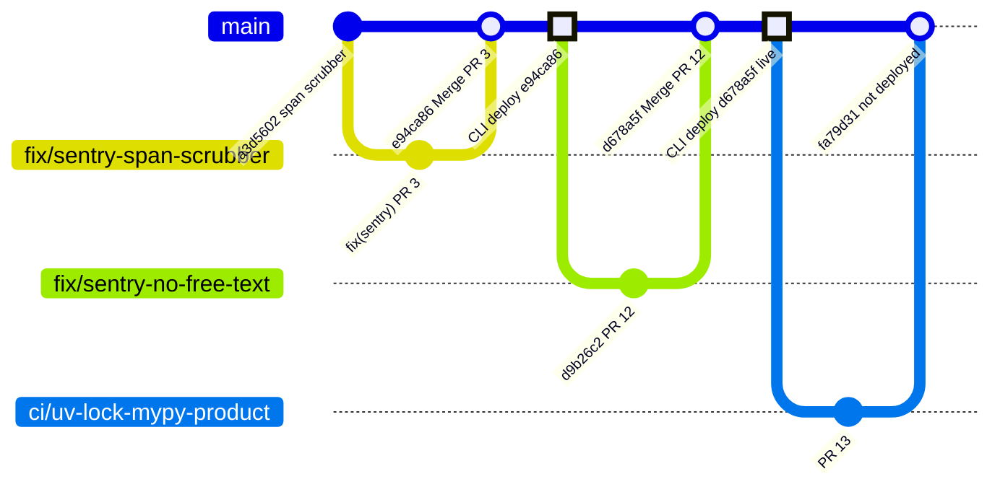

# 18 — Git and release workflow

Branch `main` ไม่มี branch protection (`gh api .../branches/main/protection` → 404 "Branch not protected") และ rulesets = 0.
Flow จริงจาก `git log` และ PR #2–#13: feature branch → PR (CI รันบน push + pull_request) → **merge locally** เป็น merge commit
`Merge PR #n: ...` → push main → CI บน main → owner/agent รัน `railway up --ci` จาก `git archive` ของ commit นั้น.

หมายเหตุ: commit "CLI deploy ..." ในกราฟเป็น marker แทน Railway deployment (ไม่มี commit จริง).

```mermaid
flowchart LR
  B["Branch from main"] --> P["Open PR"]
  P --> CI["Check + Shared runtime on PR"]
  CI --> R["Review (Codex Stop hook / agent review)"]
  R --> ML["git merge locally, push main"]
  ML --> CM["CI on main"]
  CM --> GA["git archive main"]
  GA --> RU["railway up --ci, cliMessage names the SHA"]
  RU --> HC["Railway healthcheck /readyz"]
  HC --> LV["Live"]
```

- ไม่มี git tag หรือ GitHub release. Version ใน `pyproject.toml` คงที่ `0.1.0`.
- Deploy ไม่ถูก gate โดย CI อัตโนมัติ: ไม่มีการเชื่อม Railway กับ GitHub; ลำดับ "CI green ก่อน deploy" เป็นวินัยของผู้ deploy (PR #2–#12 deploy ~3 นาทีหลัง merge ขณะ CI บน main ยังอาจรันอยู่).
- Branch ค้าง: `origin/sentry-hardened-scrubber` (PR #1 open, superseded ตาม ops record) และ branch ของ PR ที่ merge แล้ว.

Sources: `git log origin/main`, `git branch -r`, `gh pr list --state all`, `gh api repos/bookchaowalit-backend/platform-commerce/branches/main/protection`, `gh api .../rulesets`, `.github/workflows/check.yml`, `.github/workflows/shared-runtime.yml`, `pyproject.toml`, Railway GraphQL `deployments` (read 2026-11-03), ops record: book-platforms-status (2026-11-03)

## Open questions
- ปิด PR #1 และลบ branch ที่ merge แล้วหรือไม่?
- ต้องการ gate "deploy only after main CI green" แบบอัตโนมัติ (เช่น deploy job ใน Actions) หรือคง CLI?
