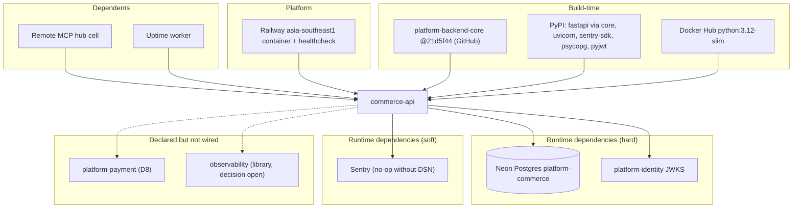

# 19 — Service dependency map

| Dependency | Kind | If down |
|---|---|---|
| Neon | hard | `/readyz` 503, data routes 500/504 |
| Identity JWKS | hard for auth | 401 on all `/v1` after key cache expires (≤ 60 s) |
| Sentry | soft | errors not reported; requests unaffected |
| Railway | host | service down |
| GitHub / PyPI / Docker Hub | build | cannot build new image |

Sources: `src/platform_commerce/__main__.py`, `src/platform_commerce/_sentry.py`, `Dockerfile`, `pyproject.toml`, `uv.lock`, `contract.json`, `.railway/railway.ts`, `platform-backend-core@21d5f44` `auth.py`, `db.py`, ops record: book-platforms-status (2026-11-03)

## Open questions
- ไม่มี
