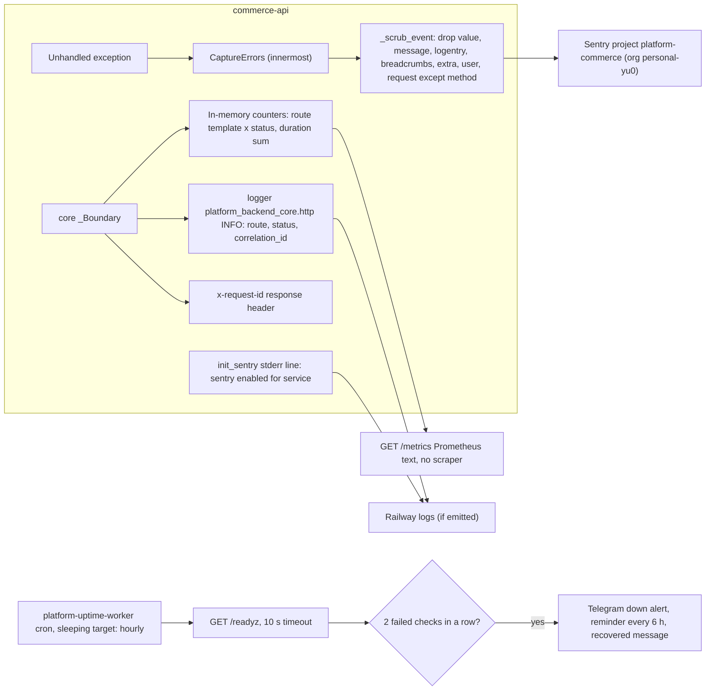

# 20 — Observability

| Signal | Instrumentation | Watched by |
|---|---|---|
| Errors | `sentry-sdk` via `CaptureErrors` (`handled: False`), errors only, no tracing | Sentry project `platform-commerce`; alert rules not in repo |
| Readiness | core `/readyz` + `commerce_schema` | uptime worker target `commerce-api` (`sleeps`: probed only in first 5 min of each hour) → Telegram; Railway healthcheck on deploy |
| Liveness | core `/healthz` | nobody found |
| Metrics | core `/metrics` (process memory only, reset on restart/sleep) | nobody (observability decision open) |
| Logs | core INFO line per request; uvicorn `access_log=False` | Railway log view; no shipping |
| Traces | none (`traces_sample_rate=None`) | — |
| Analytics | none | — |

Sources: `src/platform_commerce/_sentry.py`, `src/platform_commerce/app.py`, `src/platform_commerce/__main__.py`, `platform-backend-core@21d5f44` `http.py`, `bookchaowalit/platform-uptime-worker@fe04d27` `src/targets.ts` (target `commerce-api`, `SLEEPS`), `src/monitor.ts` (`FAILURES_BEFORE_DOWN = 2`, `REMINDER_HOURS = 6`, `isDue`), `src/worker.ts` (10 s timeout), `wrangler.toml` (crons), ops record: book-platforms-status (2026-11-03)

## Open questions
- Repo นี้ไม่ configure Python logging: INFO line ของ core ถึง Railway logs จริงหรือไม่?
- Sentry alert rule ของ project `platform-commerce` ส่งไปที่ไหน (email/Telegram)?
- Uptime probe timeout 10 s กับ cold start (Railway wake + Neon resume 6–9 s ตาม ops record) — มี false "down" หรือไม่? (down ต้อง fail 2 ครั้ง = ~2 ชั่วโมงสำหรับ sleeping target).
