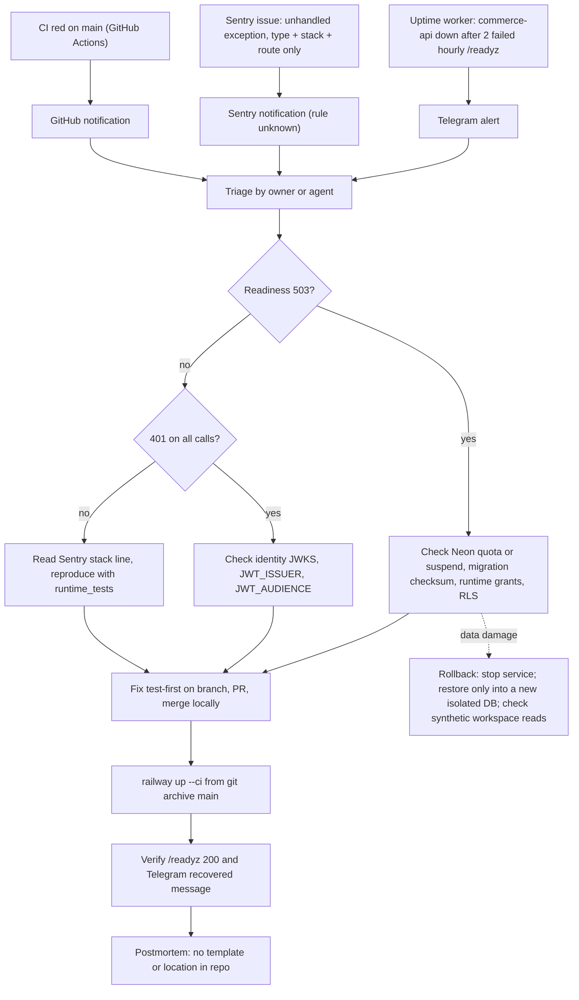

# 21 — Incident response

ไม่มี RUNBOOK.md ใน repo. Flow นี้ประกอบจาก alert channel ที่มีจริง (uptime worker → Telegram, Sentry) และ rollback rule ใน `docs/runtime.md`.

ช่องทางและข้อเท็จจริง:
- Uptime: down = 2 consecutive failures; reminder ทุก 6 ชั่วโมง; ส่ง "recovered" เมื่อกลับมา (uptime worker `src/monitor.ts`).
- Sentry: errors only; message text ถูกตัด จึง triage จาก exception type + file/function/line.
- Startup failure: process exit ด้วยข้อความคงที่ `Service configuration or dependency unavailable` (ไม่บอก variable) → ดู Railway deploy status.
- Known cause ในอดีต: Neon `empire-platform` quota (ops record) — commerce ใช้ project ของตัวเองแล้ว.

Sources: `docs/runtime.md` ("Rollback", "Staging plan"), `src/platform_commerce/__main__.py`, `src/platform_commerce/_sentry.py`, `src/platform_commerce/store.py` (`ready`), `.github/workflows/check.yml`, `bookchaowalit/platform-uptime-worker@fe04d27` `src/monitor.ts`, `src/targets.ts`, ops record: book-platforms-status (2026-11-03)

## Open questions
- Severity levels, on-call, และที่เก็บ postmortem — ไม่ได้กำหนด.
- Rollback ของ code (redeploy commit ก่อนหน้า ด้วย `railway up` หรือ Railway rollback ของ deployment เดิม) — ยังไม่เขียนไว้.
