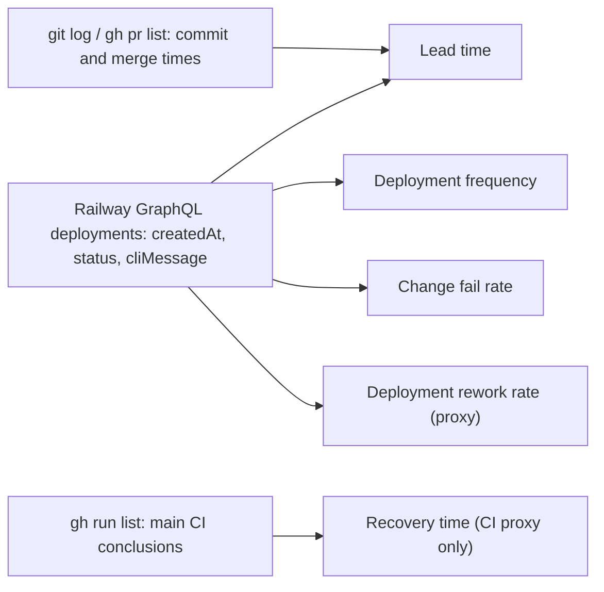

# 22 — DORA metrics

Window: 90 วันถึง 2026-11-03 (repo เริ่ม 2026-09-17; runtime deploy แรก 2026-10-29). Deploy ทั้งหมดเป็น **Railway CLI upload**
(`railway up --ci`) — Railway deployment ไม่มี `commitHash`; ผูกกับ commit ได้เฉพาะเมื่อ `cliMessage` ระบุ SHA. GitHub Actions ไม่ deploy
ดังนั้น `gh run list` ใช้วัดได้แค่ CI ไม่ใช่ deploy.



## Commands

```bash
# Deployments (read-only; token from the Railway CLI login, value never printed)
curl -s https://backboard.railway.com/graphql/v2 -H "Authorization: Bearer $RAILWAY_TOKEN" -H 'Content-Type: application/json' \
  -d '{"query":"{ deployments(first: 50, input: {projectId: \"9307c52a-d8bd-465c-900d-6e2d20aa8cac\", serviceId: \"9a99050a-5077-4831-a2db-7f50e66ac042\"}) { edges { node { createdAt status meta } } } }"}'
# PR open/merge and commit times
gh pr view <n> -R bookchaowalit-backend/platform-commerce --json mergedAt,commits
# CI on main
gh run list -R bookchaowalit-backend/platform-commerce --limit 200 --json workflowName,headBranch,conclusion,createdAt,headSha
# Commit activity
git log origin/main --since='90 days ago' --format=%ad --date=short | sort | uniq -c
```

## Values (computed 2026-11-03)

| Metric | How measured here | Value |
|---|---|---|
| Deployment frequency | Railway deployments of `commerce-api` (production) | **19 in 90 days**, all on 4 days: 2026-10-29 (6), 10-30 (1 redeploy), 11-02 (10), 11-03 (2). Status: 1 SUCCESS (live) + 18 REMOVED (superseded), 0 FAILED |
| Lead time for changes | first PR commit → Railway deploy whose `cliMessage` names the merge SHA (11 deploys, PR #2–#12) | **median 9.1 min** (range 6.2–23.5 min); merge → deploy median 3.2 min. The 7 deploys of 10-29/10-30 have no SHA → not computable |
| Change fail rate | deploys followed by a failure or rollback | **0 FAILED of 19** at platform level. True rate **not computable**: no incident or rollback record |
| Failed deployment recovery time | failure → restored | **not computable** (no failed deployment, no incident log). CI proxy: main Check red 2026-10-13 03:35 UTC (`1a75145`, `86096a6`, rename) → green 2026-10-28 17:44 UTC (`5f42c4b`) ≈ 15.6 days, before any runtime existed |
| Deployment rework rate | unplanned deploys to fix production issues | **not computable** strictly. Proxy: 10 of 19 deploys (PR #3–#12) were follow-up `fix(sentry)` scrubber changes after review of PR #2 (found in review, not production incidents); 1 more is a duplicate deploy of `0c94267` |

ข้อจำกัด:
- Commit SHA ของ deploy มาจาก `cliMessage` ที่คนพิมพ์ — ไม่ใช่ข้อมูลที่ Railway ยืนยัน.
- Main `fa79d31` (CI/tooling) ไม่ได้ deploy; ไม่ใช่ change ต่อ runtime (`git diff --stat d678a5f fa79d31 -- src Dockerfile .railway/railway.ts` ว่าง).
- Git commit dates ใน repo ปน timezone (+0700 และ UTC).

Sources: Railway GraphQL `deployments` (project `platform-commerce`, service `commerce-api`, read 2026-11-03), `gh pr list --state all`, `gh pr view 2..12 --json mergedAt,commits`, `gh run list`, `git log origin/main`, ops record: book-platforms-status (2026-11-03)

## Open questions
- ใส่ commit SHA ใน `cliMessage` ทุกครั้ง (หรือตั้ง `SENTRY_RELEASE`) เพื่อให้วัด lead time ได้ตลอด — ทำเป็น rule หรือไม่?
- นิยาม "failed deployment" และที่บันทึก incident สำหรับ service นี้.
